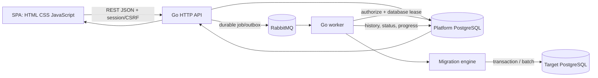

# IF3110 K03-06 — Database Migration Management Platform

Platform ini mengelola akses bersama ke beberapa database PostgreSQL dan migration berversi. Admin mendaftarkan user, group, koneksi, dan grant. User melihat database sesuai grant group; perubahan schema/data dikirim sebagai migration, direview leader group terkait, lalu diproses secara asynchronous oleh worker.

```text
Login → Access Control → Select Database → View Schema/Data
      → Create Revision → Review/Approval → Queue → Worker
      → Lock/Revalidation → Execute → Commit/Rollback → History/Audit
```

## Isi README

- [Menjalankan aplikasi](#menjalankan-aplikasi)
- [Konfigurasi environment](#konfigurasi-environment)
- [Arsitektur dan alur approval](#arsitektur-dan-alur-approval)
- [Migration, batch, dan riwayat](#migration-batch-dan-riwayat)
- [Pemulihan lock jika worker gagal](#pemulihan-lock-jika-worker-gagal)
- [Dataset besar dan benchmark UPDATE](#dataset-besar-dan-benchmark-update)
- [Logging dan tracing](#logging-dan-tracing)
- [Observability](#observability)
- [REST API](#rest-api)
- [Pengujian beban k6](#pengujian-beban-k6)

## Menjalankan aplikasi

Prasyarat: Docker Engine dan Docker Compose v2. Salin konfigurasi lalu ganti semua password contoh dengan nilai unik. Pertahankan `PLATFORM_DB_PASSWORD`, `TARGET_DB_PASSWORD`, `RABBITMQ_PASSWORD`, dan `DB_CREDENTIAL_KEY` selama volume terkait masih digunakan.

```sh
cp .env.example .env
openssl rand -base64 32  # gunakan hasilnya untuk DB_CREDENTIAL_KEY
docker compose up --build -d
docker compose ps
docker compose logs -f app worker
```

Compose menjalankan aplikasi web, worker Go, PostgreSQL platform, PostgreSQL target demo, dan RabbitMQ. Web serta worker menunggu database dan broker sehat. Buka `http://localhost:${APP_HOST_PORT}` (default `8080`) dan login sebagai bootstrap admin dari `.env`.

Untuk mengisi data demo, termasuk koneksi `shop`/`analytics`, user, group, grant, tabel contoh, dan dataset `large_orders`, jalankan seeder sekali:

```sh
docker compose run --rm --entrypoint /seed app
```

Seeder idempotent untuk data contoh. `SEED_USER_PASSWORD` dipakai oleh akun demo (`root2`, `user1`–`user5`); bootstrap admin memakai `BOOTSTRAP_ADMIN_PASSWORD`. Jangan memakai nilai password contoh di luar lingkungan lokal.

```sh
docker compose down       # menghentikan stack, mempertahankan volume
docker compose down -v    # menghapus data platform, target, dan RabbitMQ
```

## Konfigurasi environment

| Variabel | Fungsi |
| --- | --- |
| `APP_HOST_PORT` | Port host yang dipetakan ke port aplikasi container 8080. |
| `HTTP_ADDR` | Alamat listen aplikasi di container; biasanya `:8080`. |
| `PLATFORM_DB_PASSWORD` | Password PostgreSQL platform. Perubahan tidak mengubah password di volume yang sudah diinisialisasi. |
| `TARGET_DB_PASSWORD` | Password server PostgreSQL target. |
| `RABBITMQ_PASSWORD` | Password broker RabbitMQ. |
| `BOOTSTRAP_ADMIN_USERNAME`, `BOOTSTRAP_ADMIN_PASSWORD` | Admin awal platform. Password saat ini harus 12–72 byte. Bootstrap tidak mereset akun yang sudah ada. |
| `DB_CREDENTIAL_KEY` | Kunci base64 dari 32 byte untuk enkripsi password koneksi target; buat dengan `openssl rand -base64 32`, lalu simpan tetap. |
| `SEED_USER_PASSWORD` | Password untuk user yang dibuat seeder. Seeder saat ini menolak kurang dari 12 karakter. |
| `SEED_LARGE_ROWS` | Jumlah target baris `large_orders`; default 3.000.000. Seeder menambah baris hingga ID target dan mengukur ulang UPDATE pada semua baris yang ada. |
| `ASYNC_MIGRATIONS` | Mengatur pemrosesan migration asynchronous melalui queue. |
| `WORKER_SLOTS` | Jumlah job yang dapat diproses worker secara bersamaan (default 4). |
| `MIGRATION_BATCH_TIMEOUT` | Batas waktu per batch (default `5m`). |
| `LOCK_LEASE` | Masa berlaku lease lock database (default 30 detik); harus lebih lama daripada heartbeat 10 detik. |
| `OTEL_TRACES_EXPORTER` | `console` menulis span ke stdout; `otlp` mengirim ke Collector; `console,otlp` mengaktifkan keduanya. `none` mempertahankan korelasi tanpa ekspor span. |
| `OTEL_LOGS_EXPORTER` | `otlp` mengirim log ke Collector; default `none` tetap menulis log JSON lokal. |
| `OTEL_EXPORTER_OTLP_ENDPOINT` | Endpoint OTLP HTTP; pada Compose `http://otel-collector:4318`. |
| `METRICS_ADDR` | Listener Prometheus app/worker; gunakan `:9090` sesuai konfigurasi scrape. Tidak perlu dipublikasikan ke host. |
| `GRAFANA_ADMIN_PASSWORD` | Password akun admin Grafana (default Compose `admin`); anonymous Viewer juga diaktifkan untuk demo lokal. |
| `COOKIE_SECURE` | Aktifkan atribut `Secure` pada cookie bila aplikasi disajikan melalui HTTPS. |

## Arsitektur dan alur approval



1. Admin memberi group akses `VIEW_ONLY` atau `VIEW_EDIT`, dan menetapkan leader pada setiap group yang mempunyai grant.
2. Pengguna dengan akses `VIEW_EDIT` membuat revisi migration. Revisi yang dikirim untuk review dikunci; perubahan setelah itu memerlukan revisi baru.
3. **Semua leader group yang mempunyai grant pada target wajib menyetujui**, termasuk group `VIEW_ONLY`. Satu penolakan menolak review; persetujuan yang belum lengkap membuatnya tetap pending.
4. Setelah approval lengkap, pengguna mengajukan eksekusi `APPLY`, `ROLLBACK`, atau `FORWARD`. API menyimpan job dan langsung mengembalikan ID; SQL tidak berjalan dalam request HTTP.
5. Worker mengambil job, memperoleh lock target, memeriksa ulang izin/approval/revisi, kemudian memanggil migration engine. Hasil, attempt, history, dan progres batch disimpan di platform; SQL berjalan pada target PostgreSQL.

### Autentikasi dan access control

Session server-side menggunakan identifier acak opaque dalam cookie `HttpOnly`; database platform menyimpan hash identifier. Session memiliki idle timeout, absolute lifetime, rotasi identifier, grace singkat untuk identifier sebelumnya, dan token CSRF untuk mutasi. Mutasi dengan identifier lama saat grace ditolak. Logout mencabut session di backend.

Platform Admin mengelola akun/group/koneksi/grant, tetapi status admin **tidak** memberikan akses otomatis ke setiap target. Akses database diberikan melalui group: `VIEW_ONLY` untuk baca dan `VIEW_EDIT` untuk operasi edit yang diizinkan. Jika user mendapat beberapa grant, tingkat efektif tertinggi yang berlaku. Backend menghitung izin pada setiap operasi.

## Migration, batch, dan riwayat

Revisi menyimpan SQL `up` serta SQL `down`, atau alasan bahwa revisi irreversible. Hash definisi menjaga isi revisi immutable setelah dikunci untuk review. Migration mengikuti urutan linear. Rollback hanya membatalkan migration aktif terakhir yang reversible; forward menjalankan ulang versi yang telah dibatalkan dan tidak otomatis menjalankan versi selanjutnya. History merekam eksekusi/attempt; filter `hide_rollback` hanya menyembunyikan pasangan rollback dari tampilan.

Mode normal menjalankan satu SQL dalam transaction. Mode batch menjalankan SQL yang memang ditulis untuk cursor dan range batch; platform tidak memecah SQL arbitrary secara otomatis. Setiap batch memakai transaction sendiri dan menyimpan checkpoint bersama perubahan batch sebelum commit. Retry melanjutkan dari checkpoint; batch yang sudah commit tidak diulang. Rollback batch adalah kompensasi SQL `down` per batch dalam urutan terbalik, bukan rollback satu transaction besar.

Contoh SQL benchmark untuk `public.large_orders`:

```sql
-- Up; batch executor mengisi $1 dan $2 dari cursor/range.
UPDATE public.large_orders
SET amount_cents = round(amount * 100)::bigint
WHERE id > $1 AND id <= $2;

-- Down
UPDATE public.large_orders
SET amount_cents = NULL
WHERE id > $1 AND id <= $2;
```

Buat revisi dengan `table=public.large_orders`, cursor `id`, ukuran batch `10000`, lalu jalankan alur review dan approval biasa. Dengan demikian benchmark batch memakai tabel yang sama dengan UPDATE tanpa batching.

## Pemulihan lock jika worker gagal

Lock disimpan per database di Platform PostgreSQL sebagai lease dengan `owner`, `execution_id`, waktu kedaluwarsa, dan fencing token yang selalu meningkat. Worker memperbarui lease tiap 10 detik (default); lease default 30 detik. Fencing token melindungi penyimpanan status job di platform dari worker lama. Di target, advisory lock melindungi eksekusi SQL: lock session untuk batch bertahan di antara commit dan dilepas saat koneksi ditutup; checkpoint disimpan atomis dengan perubahan batch.

Jika worker berhenti, heartbeat berhenti. Setelah lease kedaluwarsa, worker lain dapat mengambil lock lewat operasi acquire; baris lock lama diganti dengan owner dan token baru. Sweeper berjalan setiap 10 detik dan menandai job `RUNNING` yang tidak lagi memiliki lease aktif sebagai `NEEDS_RECONCILIATION`, serta execution menjadi `UNKNOWN`. Sistem tidak langsung mengulang SQL yang hasil commit-nya tidak pasti. Periksa ledger/checkpoint target dan riwayat platform terlebih dahulu; rekonsiliasi harus menetapkan apakah eksekusi berhasil atau aman dilanjutkan. Untuk batch, checkpoint committed menjadi batas resume.

## Dataset besar dan benchmark UPDATE

`seed/large.go` membuat `public.large_orders` memakai `generate_series` dalam potongan 500.000 baris. Default `SEED_LARGE_ROWS=3000000`. Seeder lalu mengukur `UPDATE public.large_orders SET amount_cents = round(amount * 100)::bigint` pada seluruh baris dalam transaction dan melakukan rollback pengukuran agar tabel kembali siap untuk migration batch.

Jalankan seeder dan catat output berikut pada mesin/versi PostgreSQL yang dipakai untuk demo:

```sh
docker compose run --rm --entrypoint /seed app
```

Output seeder menampilkan jumlah baris, jumlah baris yang di-update, durasi UPDATE, dan peringatan jika durasi belum melewati satu detik. Catat hasil pengukuran aktual di sini sebelum pengumpulan:

| Lingkungan | Row diperbarui | Durasi UPDATE tanpa batch | Hasil syarat `> 1 s` |
| --- | ---: | ---: | --- |
| Isi setelah menjalankan seed; default dataset 3.000.000 row | — | — | Belum dicatat pada artefak repository |

Jika durasi tidak lebih dari satu detik, naikkan `SEED_LARGE_ROWS` lalu seed ulang. Nilai row dan durasi harus berasal dari output run yang sama; jangan memakai angka dari mesin berbeda. Karena pengukuran di-rollback, dataset tetap dapat dipakai untuk revisi batch di atas.

## Logging dan tracing

Logger `log/slog` menghasilkan JSON ke stdout. Instrumentasi mencatat request, antrean/job, lock, SQL read-only maupun mutasi, batch, retry, hasil transaction, dan error. Atribut SQL mencakup query yang disamarkan, parameter aman, row count bila tersedia, durasi, SQLSTATE, attempt/batch serta ID job/execution. Credential, session identifier, dan nilai sensitif disamarkan. OpenTelemetry menghubungkan trace API → queue → worker → lock → query; trace context dibawa pada pesan job. Exporter console aktif secara default; Collector terpusat, metrik Prometheus, dan Grafana tersedia sebagai opsi.

Contoh berikut **representatif dan disanitasi**, bukan capture dari run tertentu:

```json
{"time":"2026-11-27T10:00:00Z","level":"INFO","msg":"sql execution finished","event":"sql.result","status":"ok","database_id":1,"query":"UPDATE public.large_orders SET amount_cents = ... WHERE id > ? AND id <= ?","row_count":10000,"duration_ms":84.2,"job_id":"<job-id>","trace_id":"<trace-id>","span_id":"<span-id>"}
```

Exporter stdout OpenTelemetry mencetak span berisi nama operasi, trace/span ID, durasi, atribut seperti `job.id`, `database.id`, `db.system=postgresql`, dan status/error. Bentuk serialisasi exporter tergantung versi OpenTelemetry; ambil contoh output aktual dari `docker compose logs app worker` saat menyiapkan demo, dan jangan menyertakan secret/SQL sensitif.

Contoh potongan output span console (ilustrasi disanitasi; bukan hasil benchmark):

```json
{
  "Name": "db.query",
  "SpanContext": {
    "TraceID": "11111111111111111111111111111111",
    "SpanID": "2222222222222222",
    "TraceFlags": "01"
  },
  "StartTime": "2026-11-27T10:00:00Z",
  "EndTime": "2026-11-27T10:00:00.0842Z",
  "Attributes": [
    {"Key": "db.system", "Value": {"Type": "STRING", "Value": "postgresql"}},
    {"Key": "db.row_count", "Value": {"Type": "INT64", "Value": 10000}}
  ],
  "Status": {"Code": "Ok", "Description": ""}
}
```

## Observability

Stack observability tersedia di profile `observability` pada `compose.yaml`. Tambahkan/ubah konfigurasi berikut di `.env`:

```env
OTEL_TRACES_EXPORTER=console,otlp
OTEL_LOGS_EXPORTER=otlp
OTEL_EXPORTER_OTLP_ENDPOINT=http://otel-collector:4318
METRICS_ADDR=:9090
GRAFANA_ADMIN_PASSWORD=pilih-password-grafana
```

```sh
docker compose --profile observability up --build -d
docker compose --profile observability ps
docker compose logs --tail=100 otel-collector app worker
```

Perubahan environment diterapkan oleh Compose dengan membuat ulang container yang konfigurasinya berubah. Profile tidak mengaktifkan exporter secara otomatis; nilai default `console`/`none` belum mengirim trace/log ke Collector. Pastikan port aplikasi berbeda dari `3000`, `9090`, dan `16686` yang dipakai UI monitoring.

| Komponen | Akses / fungsi |
| --- | --- |
| OpenTelemetry Collector | Internal `otel-collector:4318` (HTTP) / `4317` (gRPC); pipeline trace dan log pada `observability/otel-collector.yaml`. |
| Jaeger | <http://localhost:16686>; cari service `dbmp-platform` atau `dbmp-worker` dan trace lintas API/queue/worker. |
| Loki | Internal `loki:3100`; penyimpanan log OTLP, diakses melalui Grafana Explore. |
| Prometheus | <http://localhost:9090>; halaman `/targets` menampilkan target `dbmp-app` dan `dbmp-worker`. Scrape tiap 5 detik menggunakan DNS discovery agar replica worker ikut terpantau. |
| Grafana | <http://localhost:3000>; dashboard **DBMP - Queue, Migrations & DB Pool** diprovision otomatis. |

Alur trace/log: aplikasi dan worker → OTLP HTTP → Collector → Jaeger (trace) / Loki (log). Prometheus mengambil `/metrics` pada port 9090 masing-masing app/worker. Grafana memakai datasource Prometheus, Loki, dan Jaeger yang diprovision lewat `observability/grafana/provisioning/`.

Dashboard `observability/grafana/dashboards/dbmp.json` menampilkan jumlah job per status, queue/lock wait, durasi migration, job selesai, retry, batch/row diproses, koneksi pool platform aktif/idle, waktu tunggu koneksi, dan log. Histogram/rate dapat kosong sebelum ada aktivitas atau cukup sampel. Status job merupakan data platform bersama; dashboard memakai `max by (status)` agar jumlah tidak terhitung berulang dari beberapa proses.

Untuk korelasi, lakukan query atau migration dari SPA, cari log di Grafana Explore dengan `{service_name=~"dbmp-.+"}`, lalu gunakan `trace_id` untuk membuka trace Jaeger. Pastikan trace yang sama memiliki span API, publisher/worker, lock, dan query sesuai operasi. Jika tautan korelasi tidak tampil, salin trace ID ke pencarian Jaeger dan catat masalah provisioning. Gunakan rentang waktu yang mencakup aktivitas dan tunggu ekspor/scrape beberapa detik.

Konfigurasi observability ini ditujukan untuk pengujian lokal: Grafana memiliki anonymous Viewer, dan backend monitoring belum diberi volume persisten di Compose. Restart/recreate backend dapat menghilangkan bukti observability. Simpan screenshot/export hasil pengujian yang sudah disanitasi sebelum menghentikan stack. 

## Pengujian otomatis

```sh
sh scripts/test.sh
sh scripts/test.sh -i
```

Opsi -i menyiapkan PostgreSQL dan RabbitMQ sementara untuk integration test. Pengujian manual melengkapi test otomatis.

## REST API

API JSON memakai prefix `/api/v1`; mutasi memerlukan cookie session dan header `X-CSRF-Token`. Error memakai status HTTP dan payload JSON. Endpoint yang tersedia:

| Method dan path | Kegunaan |
| --- | --- |
| `GET /api/v1/auth/login-csrf` | Mendapat token CSRF awal login. |
| `POST /api/v1/auth/login` | Login JSON. |
| `GET /api/v1/auth/session` | Memeriksa session dan mendapatkan CSRF session. |
| `POST /api/v1/auth/logout` | Logout/revocation session. |
| `GET /api/v1/admin` | Data administrasi; khusus platform admin. |
| `POST /api/v1/admin/actions` | Operasi admin yang tersedia melalui action JSON. |
| `GET /api/v1/databases` | Daftar database yang dapat diakses user. |
| `GET /api/v1/databases/{id}` | Schema/table/detail dan preview data. |
| `POST /api/v1/databases/{id}/query` | Menjalankan SQL sesuai access level dan aturan workflow. |
| `POST /api/v1/databases/{id}/explain` | Menjalankan analisis plan baca. |
| `GET /api/v1/databases/{id}/revisions` | Daftar revisi. |
| `POST /api/v1/databases/{id}/revisions` | Membuat revisi migration. |
| `POST /api/v1/databases/{id}/revisions/{revisionId}/review` | Mengajukan action untuk review. |
| `GET /api/v1/databases/{id}/reviews` | Daftar review. |
| `GET /api/v1/databases/{id}/reviews/{reviewId}/decisions` | Daftar keputusan leader. |
| `POST /api/v1/reviews/{id}/decision` | Leader menyetujui/menolak review. |
| `POST /api/v1/databases/{id}/executions` | Submit eksekusi asynchronous; merespons `202 Accepted`. |
| `GET /api/v1/jobs/{id}` | Status dan progres job. |
| `GET /api/v1/databases/{id}/history` | Riwayat eksekusi; mendukung `hide_rollback=true`. |
| `GET /health` | Health check aplikasi/platform DB. |

Endpoint HTML M1 tetap tersedia untuk transisi. Semua otorisasi tetap diperiksa di backend; menyembunyikan tombol pada SPA bukan kontrol akses.

Route HTML/form lama yang masih tersedia mencakup `GET /`, `/login`, `/dashboard`, `/admin`, `/databases`, `GET /databases/{id}`, form admin `POST /admin/...`, serta route viewer lama. Route eksekusi migration sinkron M1 tidak digunakan untuk alur migration baru; eksekusi M2 harus melalui workflow dan job asynchronous.

## Pengujian beban k6

The stress test suite evaluates the platform's HTTP API responsiveness, per-database migration locking, RabbitMQ job dispatch, and async worker execution under concurrent load. It consists of three components:

1. **Migration Pool Seeder (`k6/seed/main.go`)**
   - Connects directly to the platform PostgreSQL database and ensures the bootstrap admin user belongs to a `k6-testers` group with `VIEW_EDIT` access and group leader status on all target connections.
   - Ensures a lightweight `public.k6_stress_log` table exists on both target databases (`shop` and `analytics`).
   - Seeds `K6_MIGRATION_POOL` (default `150`) pre-approved, reversible `APPLY` migrations in `NORMAL` execution mode per database (`300` total) and writes their IDs (`database_id`, `migration_id`, `revision_id`, `approval_request_id`) to `k6/migrations.json`.
2. **k6 Load & Migration Script (`k6/stress.js`)**
   - Maintains per-VU authenticated sessions (`noCookiesReset: true`) using the platform's CSRF login flow (`/api/v1/auth/login-csrf`, `/api/v1/auth/login`, `/api/v1/auth/session`) and automatically re-authenticates if a `401` is ever encountered.
   - Runs **three concurrent ramping-VU scenarios** over ~2 minutes (`125s` total stages + graceful ramp-down) and exports metrics to `k6/summary.json`.
3. **Runner Script (`scripts/k6.sh`)**
   - Loads `.env`, runs `k6/seed` inside a `golang:1.26-alpine` container attached to the Docker Compose network, and executes `grafana/k6:latest run /work/k6/stress.js`.

---

### Test Scenarios

| Scenario | Executor | VU Ramp Profile | Workload & Purpose |
| :--- | :--- | :--- | :--- |
| **`api_read_access`** | `ramping-vus` (`gracefulRampDown: 10s`) | `2` → `10` (20s) → `25` (30s) → `45` (30s) → `10` (30s) → `0` (15s) | Exercises authenticated read & query endpoints: `GET /api/v1/databases`, `GET /api/v1/databases/{id}`, `GET /api/v1/databases/{id}/history`, and `POST /api/v1/databases/{id}/query` (`SELECT 1 AS ok`), with `0.3s` think time per iteration. |
| **`migration_same_db`** | `ramping-vus` (`gracefulRampDown: 15s`) | `1` → `2` (20s) → `5` (30s) → `8` (30s) → `2` (30s) → `0` (15s) | Submits pre-approved migrations targeting **`shop`** via `POST /api/v1/databases/{id}/executions` (`202 Accepted`) and polls `GET /api/v1/jobs/{id}` every `250 ms` (`POLL_INTERVAL_SEC = 0.25`, timeout `60s`). Tests per-database lock contention (`409 Conflict` with `0.5s` backoff) and serialized queue execution. |
| **`migration_diff_db`** | `ramping-vus` (`gracefulRampDown: 15s`) | `1` → `2` (20s) → `4` (30s) → `6` (30s) → `2` (30s) → `0` (15s) | Alternates pre-approved migrations between **`analytics`** and **`shop`** and polls until terminal status (`SUCCEEDED`, `FAILED`, `CANCELLED`). Tests parallel async worker throughput across independent databases. |

**Peak Concurrency:** `45` read VUs + `8` same-DB migration VUs + `6` diff-DB migration VUs = **59 concurrent VUs**.

### Pass Thresholds

Configured in `k6/stress.js`:
- `http_req_duration`: `p(95) < 1500 ms`
- `http_req_failed`: `rate < 0.05` (`< 5%`)
- `api_response_time_ms`: `p(95) < 1500 ms`
- `api_error_rate`: `rate < 0.05` (`< 5%`)
- `job_execution_success_rate`: `rate > 0.95` (`> 95%`)

---

### How to Run

1. Start the Docker Compose stack and seed the initial platform data:
   ```sh
   docker compose up -d --build
   docker compose run --rm --entrypoint /seed app
   ```
2. Run the test:
   ```sh
   ./scripts/k6.sh
   ```
3. Summary metrics are printed to stdout and saved to `k6/summary.json`.

---

### Stress Test Results (`k6/summary.json`)

| Metric                             | Measured Value | Threshold | Status |
| :--- | :--- | :--- | :--- |
| **API Response Time** | `p50`: **98.19 ms** \| `p95`: **375.27 ms** \| `avg`: **138.71 ms** \| `max`: **934.64 ms** | `p(95) < 1500 ms` | Pass |
| **Request Throughput** | **101.38 req/s** (`12,726` total requests) | — | — |
| **HTTP Error Rate** | **1.37%** (`0.013673`) | `< 5%` | Pass |
| **Queue Wait Time** | `p50`: **407.50 ms** \| `p95`: **607.00 ms** \| `avg`: **424.83 ms** \| `max`: **781.00 ms** | — | — |
| **Job Completion Duration** | `p50`: **407.50 ms** \| `p95`: **607.00 ms** \| `avg`: **425.95 ms** \| `max`: **1,084.00 ms** | — | — |
| **Jobs Completed** | **276 jobs** | — | — |
| **Job Throughput** | **2.20 jobs/s** | — | — |
| **Job Execution Success Rate** | **100.00%** (`1`) | `> 95%` | Pass |

### Analysis

1. **API Performance & Stability Under Peak Load**
   - At peak stress (`59` concurrent VUs across all three scenarios), the platform sustained **101.38 req/s** across **12,726** HTTP requests with a median latency of **98.19 ms** and a `p95` latency of **375.27 ms**—roughly **4× faster** than the `1,500 ms` `p95` threshold.
   - No HTTP request exceeded 1 second (`max`: **934.64 ms**).
2. **100% Migration Job Reliability**
   - All **276** queued migration jobs reached `SUCCEEDED` (`job_execution_success_rate: 1`), sustaining **2.20 completed jobs/s** with zero failed or timed-out jobs.
3. **Expected Contention vs. Errors (`http_error_rate: 1.37%`)**
   - k6's built-in `http_req_failed` metric counts any non-2xx/3xx status code as an error.
   - During `migration_same_db` (up to `8` concurrent VUs targeting `shop`), concurrent submissions correctly hit the platform's per-database migration lock and receive `409 Conflict`, which accounts for the `1.37%` (~174 requests) rate rather than unexpected `5xx` server errors.
4. **Queue Dispatch & Polling Granularity**
   - `queue_wait_ms` and `job_completion_duration_ms` report identical `p50` (**407.50 ms**) and `p95` (**607.00 ms**) values, with averages differing by only `1.12 ms` (**424.83 ms** vs. **425.95 ms**).
   - Because the client polls `/api/v1/jobs/{id}` every `250 ms` (`POLL_INTERVAL_SEC = 0.25`), observed completion times cluster around 2–3 polling intervals, and once a worker dequeues a job from RabbitMQ, the SQL execution itself completes in a few milliseconds (with an isolated max of `1,084 ms`).

### Hasil per tingkat beban

File `k6/summary.json` hanya menyimpan metrik agregat untuk seluruh run. Ia tidak memiliki metrik yang dikelompokkan menurut tahap ramping, sehingga angka latency/error khusus per tingkat beban tidak dapat disimpulkan dari artefak ini. Tabel berikut mencatat profil yang dijalankan dan status data yang tersedia; isi kolom pengukuran setelah menjalankan skenario terpisah atau menambahkan tagging per tingkat pada output k6.

| Tingkat | Profil VU bersamaan (read + same DB + different DB) | Analisis tujuan | Hasil ukur khusus tingkat ini |
| --- | --- | --- | --- |
| Awal/normal | 2 + 1 + 1 = 4 VU awal; ramp pertama menuju 10 + 2 + 2 | Menetapkan perilaku awal dan kapasitas normal sebelum tekanan dinaikkan. | Belum direkam terpisah |
| Beban menengah | 25 + 5 + 4 = 34 VU | Mengamati kenaikan latency saat pembacaan dan submit job bersamaan; target berbeda seharusnya tetap dapat diproses paralel. | Belum direkam terpisah |
| Puncak | 45 + 8 + 6 = 59 VU | Menguji batas beban serta serialisasi job pada target sama. Total run mencatat 1.37% HTTP error, sebagian besar diperkirakan `409` akibat lock yang memang diharapkan; hasil peak sendiri belum dipisahkan. | Belum direkam terpisah |
| Pemulihan | Turun ke 10 + 2 + 2 = 14 VU, lalu semua skenario ke 0 | Memastikan latency dan error turun kembali setelah peak, bukan hanya mengukur kapasitas maksimum. | Belum direkam terpisah |

Angka agregat run di atas menunjukkan threshold global tercapai. Jangan menyebut hasil agregat tersebut sebagai hasil khusus peak atau recovery. Untuk laporan akhir, ekspor data k6 per scenario/load band, lalu catat p95 latency, error tak terduga, job success, queue wait, dan pemulihan tiap level. Konflik lock `409` yang memang diharapkan perlu dibedakan dari error aplikasi.
